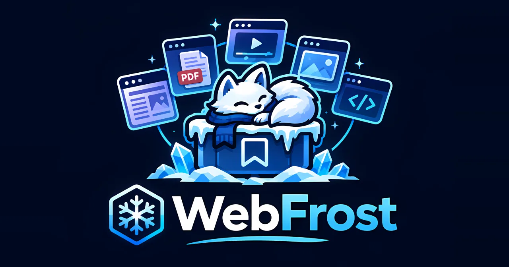
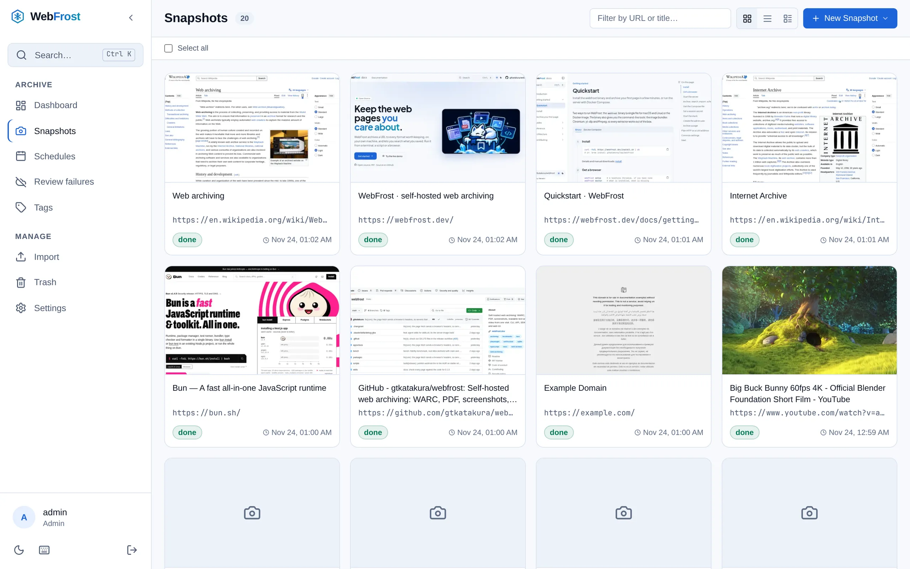

<p align="center">
  <a href="https://webfrost.dev"></a>
</p>

# WebFrost

[](https://github.com/gtkatakura/webfrost/actions/workflows/ci.yml)
[](LICENSE)
[](https://webfrost.dev)

**Keep the web pages you care about, on your own machine.** WebFrost archives a URL to every format worth
keeping and lets you search what you saved. Run it from a terminal, a script or a browser.

- **Every format from one visit.** WARC, raw HTML, readable text, PDF, a full-page screenshot, the rendered
  DOM, a self-contained HTML file and, for media pages, the video, all from one fetch and one browser
  navigation.
- **Keeps running on its own.** Cron schedules and RSS feeds run inside the server; jobs survive crashes
  and are spaced out per site.
- **Safe to put on a network.** API keys, revocable sessions, rate limits, a read-only public mode, and a
  guard that stops archived pages from reaching your internal network.
- **Plain files, no lock-in.** An archive is a folder with one SQLite database and the files next to it.
  PostgreSQL or MySQL for the metadata and an S3-compatible bucket for the files are options, not
  requirements.

<picture>
  <source media="(prefers-color-scheme: dark)" srcset=".github/assets/screenshot-dark.webp">
  
</picture>

📖 **Documentation: [webfrost.dev](https://webfrost.dev)**

> WebFrost is young (`0.x`). It works, and it is tested, but the HTTP API can still change before 1.0
> (it is versioned: `/api/v1`). See the [roadmap](ROADMAP.md).

## Install

**Docker**, for the server, the web UI and the scheduler. The image bundles Chromium, yt-dlp and ffmpeg,
so every format works out of the box, on amd64 and arm64:

```bash
curl -fsSLO https://webfrost.dev/compose.yml
echo "SESSION_SECRET=$(openssl rand -hex 32)" > .env
docker compose up -d
```

Open http://localhost:3000 and create the admin user. For a real deployment (reverse proxy, TLS,
backups) see [Deploy](https://webfrost.dev/docs/guides/deploy).

**The `webfrost` binary**, for macOS, Linux and Windows. One file with the CLI and the server:

```bash
# or: brew install gtkatakura/tap/webfrost
# Windows: irm https://webfrost.dev/install.ps1 | iex
curl -fsSL https://webfrost.dev/install.sh | sh

# a headless Chromium, if you have none; doctor says what else is missing
webfrost setup
webfrost doctor

# server, web UI and scheduler on :3000
webfrost serve
```

## Three ways in

- **Web UI**: dashboard, search with highlights, previews of every format, tags, schedules, imports. [Reference](https://webfrost.dev/docs/reference/web-ui)
- **CLI**: archive, import, search and schedule from a terminal, straight against an archive folder. [Reference](https://webfrost.dev/docs/reference/cli)
- **HTTP API**: everything the UI does, over REST, with API keys. [Reference](https://webfrost.dev/docs/reference/rest-api)

A typed TypeScript client with no dependencies, `@webfrost/sdk`, lives in [`packages/sdk`](packages/sdk)
and will be published to npm after the first release.

```bash
webfrost add https://example.com
webfrost search "example domain"

# Netscape bookmarks, OPML, RSS/Atom or a list of URLs
webfrost import bookmarks.html

# re-archive every hour
webfrost schedule add https://example.com --cron "0 * * * *"
```

```bash
curl -X POST http://localhost:3000/api/v1/snapshots \
  -H "Authorization: Bearer $WEBFROST_API_KEY" \
  -H "Content-Type: application/json" \
  -d '{"url":"https://example.com"}'
```

## Agent skills

Teach your coding agent (Claude Code, Codex, Cursor and others) to use and run WebFrost with
[skills](https://skills.sh):

```bash
npx skills add gtkatakura/webfrost
```

- `webfrost`: archive pages, search the archive, download formats, import and schedule, from the CLI
  or the HTTP API.
- `webfrost-self-host`: install, configure, secure, back up and troubleshoot your own server.

## Why WebFrost

WebFrost is inspired by [ArchiveBox](https://archivebox.io), the most mature self-hosted web archiver,
and owes it the idea: archive every page in every format worth keeping, on your own machine. It was
built for performance. ArchiveBox runs each extractor on its own, so one page is fetched and rendered
several times. WebFrost fetches a page once and opens it in the browser once, and every format comes
from those two visits. It runs as one Bun process with SQLite (or your PostgreSQL or MySQL), so
archiving many pages, on a schedule or from a big import, stays light enough for a small server.

It also treats the CLI and the HTTP API as first-class, so it is easy to drive from scripts
and other programs. ArchiveBox supports more inputs today (a browser extension, browser history, Pocket
and Pinboard exports) and has years of real-world use behind it. A [benchmark](BENCHMARKS.md) comparing
the two is in the repository; its numbers will be published once it has run. More in
[Why WebFrost](https://webfrost.dev/docs/architecture/why-webfrost).

## FAQ

**Where is my data?** In `WEBFROST_DIR` (`~/.webfrost` for the binary, `/data` in Docker): `archive.db` plus one folder per snapshot
(with `DATABASE_URL` the database is on your PostgreSQL or MySQL server; with the S3 backend the files are in a bucket). Back
it up like any folder. See [Disk layout](https://webfrost.dev/docs/reference/disk-layout).

**Can I archive pages behind a login?** Not yet: every page is fetched as an anonymous visitor. It is on the
[roadmap](ROADMAP.md).

**Can I share my archive?** Yes. With `WEBFROST_PUBLIC_READ=true` anyone can browse and search; only you can
archive, delete or change settings. See [Public read](https://webfrost.dev/docs/guides/public-read).

**Does it phone home?** No. WebFrost collects no telemetry and sends nothing anywhere except the pages
you ask it to archive. If you run an OpenTelemetry collector, you can point WebFrost at it and get
traces, metrics and logs in your own tools; it is off unless you configure it. See
[Observability](https://webfrost.dev/docs/guides/observability).

**How much does it need?** One process, plus a headless Chromium while a page is being archived. A small
VPS or a home server is enough for personal use; `WEBFROST_CONCURRENCY` limits parallel archives.

**Is it safe to archive any URL?** Archived pages cannot reach private addresses through the server or
the browser, and previews run sandboxed. Read [Security](https://webfrost.dev/docs/architecture/security)
before exposing it to other people.

## Contributing

Bug reports, ideas and pull requests are welcome. [CONTRIBUTING.md](CONTRIBUTING.md) shows how to run
WebFrost from source and what a good pull request looks like; questions
go to [Discussions](https://github.com/gtkatakura/webfrost/discussions), and security issues to
[SECURITY.md](SECURITY.md), never to a public issue.

## License

[MIT](LICENSE)
