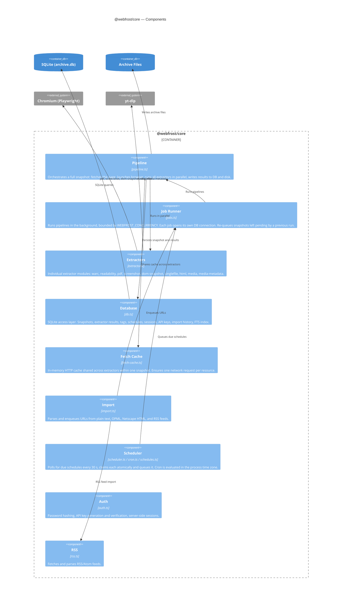

# Components

The C4 Component diagram shows the major modules inside `@webfrost/core`.

## Component notes

**Pipeline** is the central orchestrator. It fetches the page (SSRF-guarded), starts Chromium (every browser request is SSRF-guarded too), initializes the shared HTTP cache, fans out to all extractors, collects results, writes files, and sets the snapshot status: `done` when at least one extractor produced output, `failed` otherwise.

**Fetch Cache** is an in-memory cache scoped to a single snapshot run. Text extractors (WARC, Readability, HTML) share it so the page is fetched once over HTTP, not once per extractor.

**Extractors** are small, independent modules — one per output format. They receive the page handle (for browser extractors) or the fetch cache (for HTTP extractors) and return a `Buffer` or JSON object.

**Job Runner** queues pipelines started by the server (API submissions, imports, schedules) and runs at most `WEBFROST_CONCURRENCY` of them at once. On startup it re-queues snapshots left `pending` by a previous run.

**Scheduler** polls every 30 s, evaluates cron expressions (in the process time zone), atomically claims due schedules and hands them to the job runner. It runs inside the server and in `webfrost schedule worker`.

**Database** is a thin wrapper around SQLite with typed accessors for all tables. It does not use an ORM — queries are plain SQL.

See [Pipeline](/architecture/pipeline) for the sequence of events during a snapshot run.
