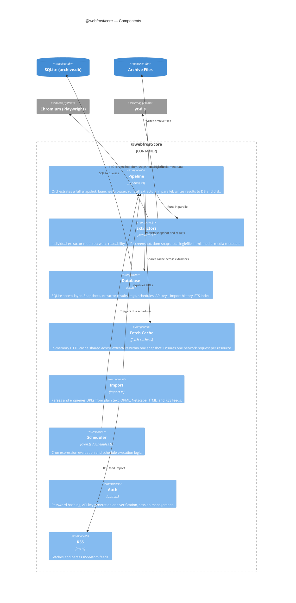

# Components

The C4 Component diagram shows the major modules inside `@webfrost/core`.

## Component notes

**Pipeline** is the central orchestrator. It creates the SQLite snapshot record, starts Chromium, initializes the shared HTTP cache, fans out to all extractors, collects results, writes files, and updates the snapshot status on completion or failure.

**Fetch Cache** is an in-memory cache scoped to a single snapshot run. Text extractors (WARC, Readability, HTML) share it so the page is fetched once over HTTP, not once per extractor.

**Extractors** are small, independent modules — one per output format. They receive the page handle (for browser extractors) or the fetch cache (for HTTP extractors) and return a `Buffer` or JSON object.

**Scheduler** evaluates cron expressions against the current time and dispatches due schedules to the pipeline. It runs as a polling loop inside the server.

**Database** is a thin wrapper around SQLite with typed accessors for all tables. It does not use an ORM — queries are plain SQL.

See [Pipeline](/architecture/pipeline) for the sequence of events during a snapshot run.
