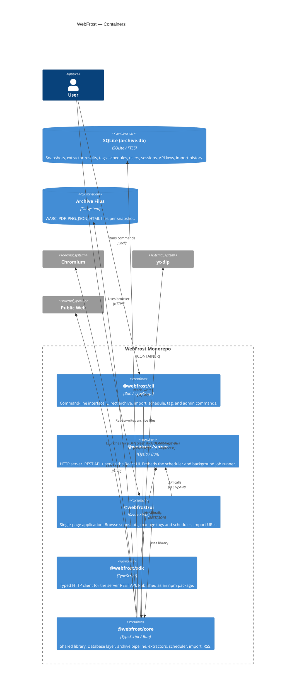

# Containers

The C4 Container diagram shows the major deployable units in WebFrost and how they communicate.

## Package responsibilities

| Package | Role | Entry point |
|---|---|---|
| `@webfrost/core` | Shared library — pipeline, extractors, DB, scheduler, import | Library, not executable |
| `@webfrost/cli` | CLI binary (`webfrost`) | `packages/cli/src/index.ts` |
| `@webfrost/server` | Elysia HTTP server + embeds the scheduler and job runner | `packages/server/src/index.ts` |
| `@webfrost/ui` | React SPA, built to `packages/ui/dist/` (served by the server) | `packages/ui/src/main.tsx` |
| `@webfrost/sdk` | Typed REST API client, published to npm | `packages/sdk/src/index.ts` |

## Key relationships

- **CLI and server both use `core`** — the pipeline logic lives once in `@webfrost/core`, not in either consumer.
- **Server embeds the scheduler** — no separate worker process needed. The scheduler (polls every 30 s) and the job runner that bounds archive concurrency (`WEBFROST_CONCURRENCY`) run inside the server process. `webfrost schedule worker` uses the same scheduler and can run next to the server on one archive, because due schedules are claimed atomically. `WEBFROST_SCHEDULER=false` disables the server's scheduler.
- **UI talks only to the server** — the React SPA makes REST calls to `@webfrost/server`. It has no direct dependency on `core`.
- **SDK is a thin REST wrapper** — typed TypeScript methods around the same REST API that the UI uses.
