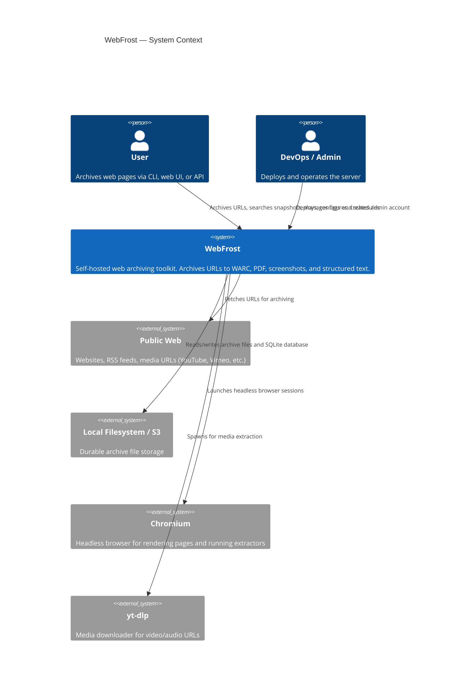

# Architecture overview

WebFrost's architecture is described using the [C4 model](https://c4model.com/). This page covers the System Context level — who uses WebFrost and what it interacts with.

For more detail, see:
- [Containers](/architecture/containers) — the major packages and how they communicate
- [Components](/architecture/components) — internals of `@webfrost/core`
- [Pipeline](/architecture/pipeline) — how a single URL archive runs end-to-end

## System Context

Who uses WebFrost and what external systems does it interact with?

## Design principles

**One browser navigation per snapshot.** Most archivers launch a separate browser session per extractor. WebFrost launches one session and runs all browser-based extractors (PDF, screenshot, DOM snapshot, SingleFile) against the same page load. This is the primary source of speed.

**One shared HTTP cache.** Non-browser extractors (WARC, Readability, HTML) share a fetch cache. The page is fetched once; all extractors read from the cache. No duplicate HTTP requests.

**Open formats only.** WARC is a standard archival format. PDF, PNG, and HTML need no special software. SQLite is readable with any client. There is no proprietary database or binary format.

**Single directory.** The entire archive — database and files — lives in one directory. Back it up with `rsync`. No external database server, no object storage required (S3 is optional).
