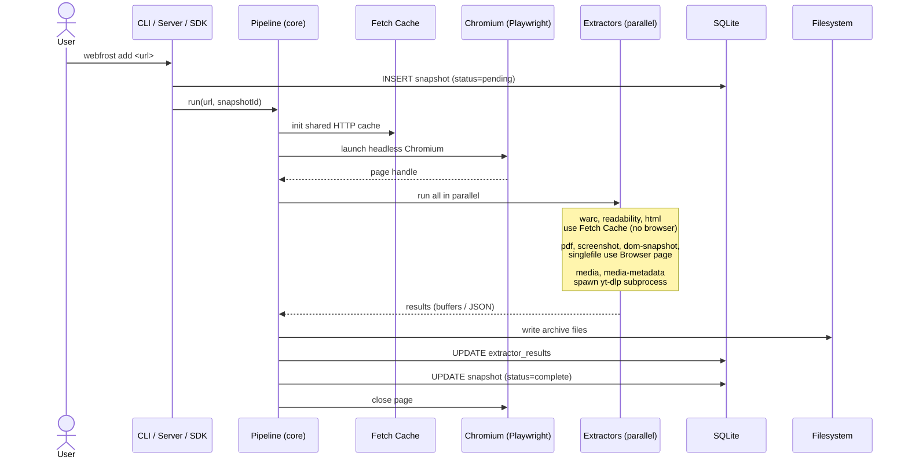
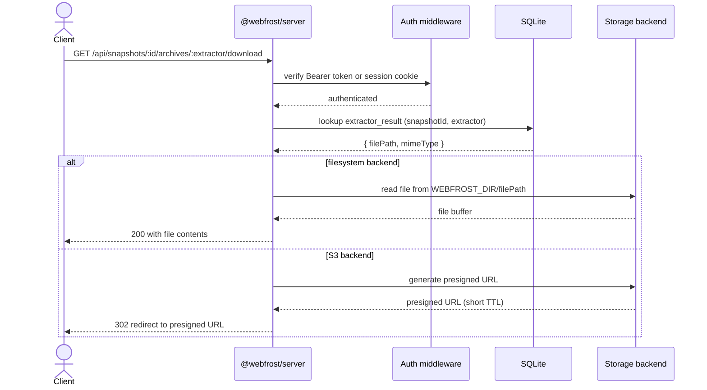
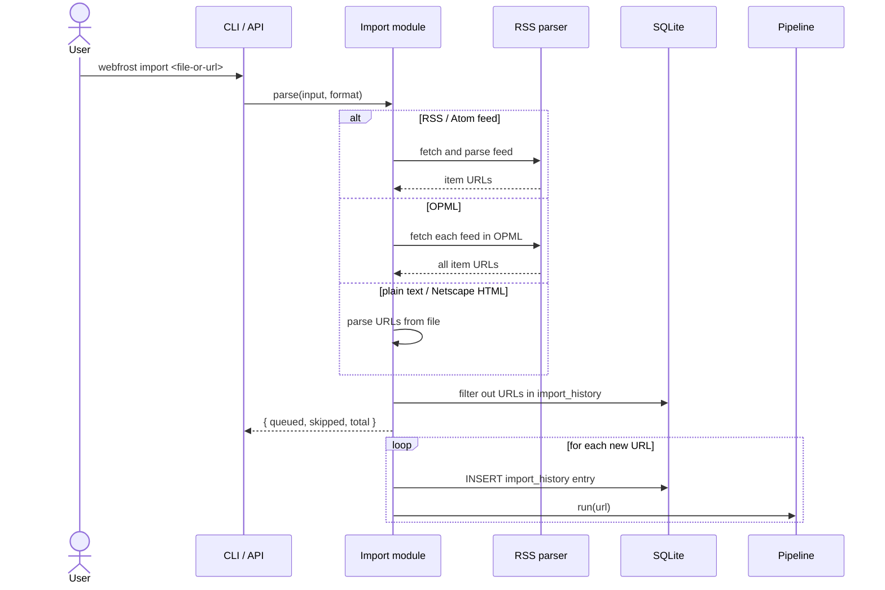
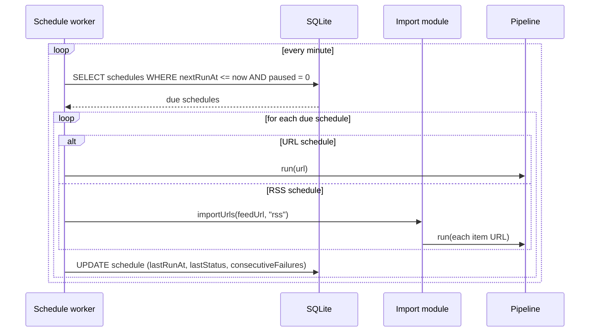

# Pipeline

How WebFrost archives a URL — from submission to stored snapshot.

## Archive pipeline

A single URL archive run from start to completion.

## Download flow

How the server resolves and serves an archive file.

## Import flow

Bulk URL import from a file or feed.

## Schedule flow

How due schedules are detected and dispatched.

