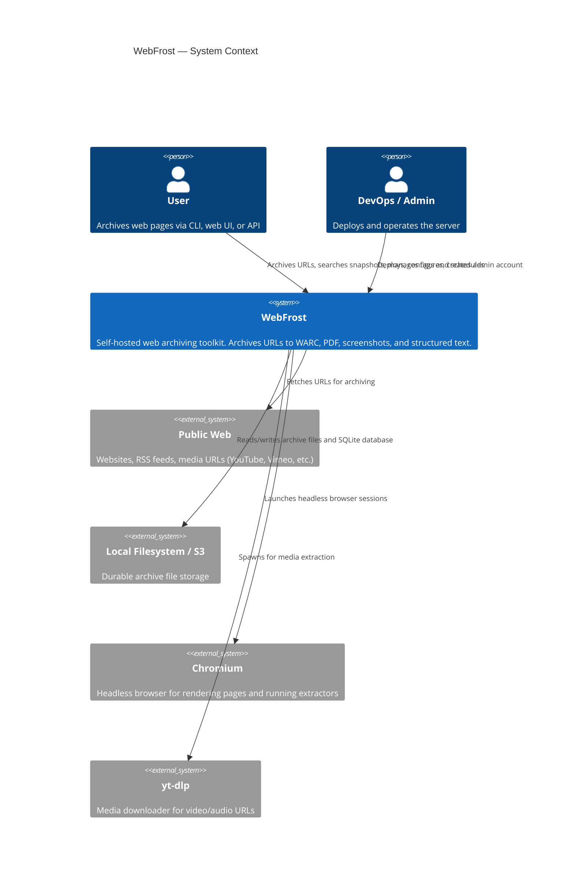
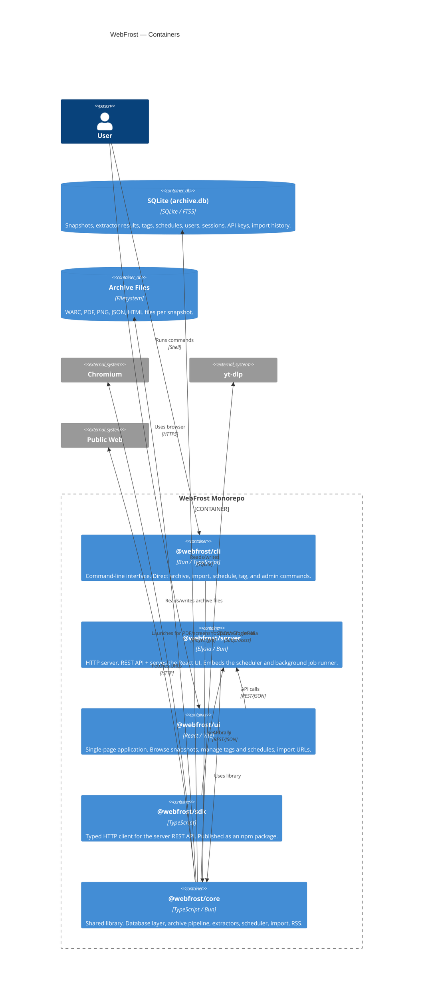
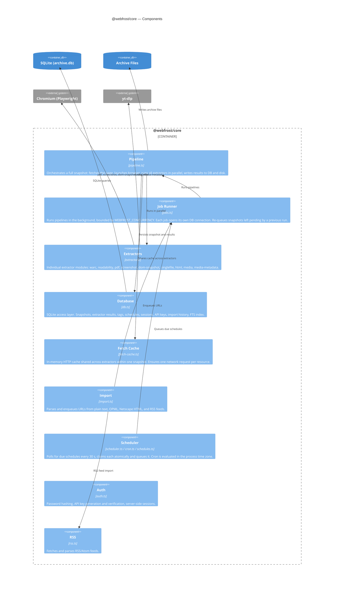

# Explanation: Architecture

WebFrost's architecture is described here using the [C4 model](https://c4model.com/) — three levels of zoom: System Context, Container, and Component.

Diagrams use [Mermaid](https://mermaid.js.org/) for portability. Standalone `.mmd` files are in [`docs/diagrams/`](../diagrams/).

---

## Level 1 — System Context

Who uses WebFrost and what external systems does it interact with?

---

## Level 2 — Containers

What are the major deployable units and how do they communicate?

---

## Level 3 — Component: `@webfrost/core`

What are the major internal components of the core library?

---

## Design decisions

- **One browser navigation per snapshot.** Playwright is launched once per URL. All browser-dependent extractors (PDF, screenshot, DOM snapshot, SingleFile) share that navigation. This avoids re-loading the page multiple times.

- **Shared HTTP cache per snapshot.** `fetch-cache.ts` caches HTTP responses in memory for the duration of the snapshot pipeline. Text-based extractors (WARC, Readability, HTML) that need raw HTTP responses draw from this cache rather than making duplicate requests.

- **SQLite + local files.** The archive is a directory on disk — the SQLite database and the files alongside it. No external database dependency. Back up the directory to back up the archive.

- **Monorepo, separate packages.** `@webfrost/core` is the library. CLI, server, and SDK are thin layers on top. Adding a new interface (e.g., a desktop app) means implementing against `core` without touching the pipeline.

For the pipeline flow in detail, see [Explanation: Pipeline](./pipeline.md).
For storage layout, see [Explanation: Storage model](./storage-model.md).
