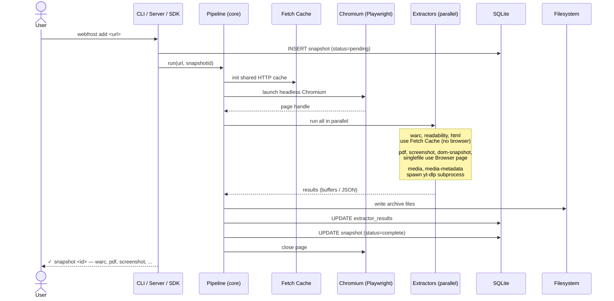
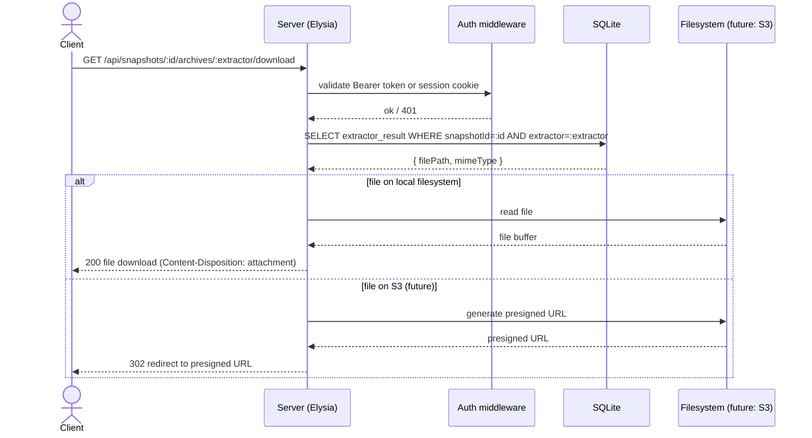
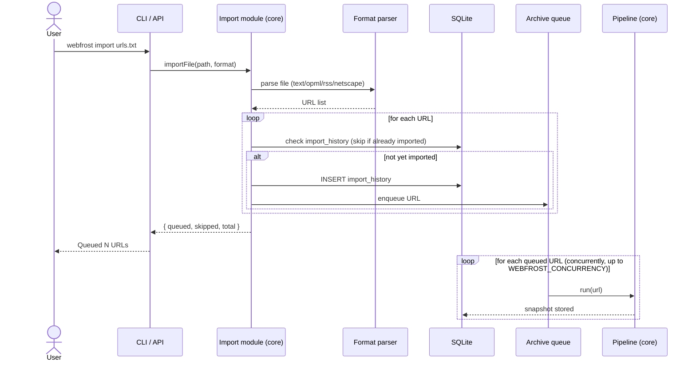
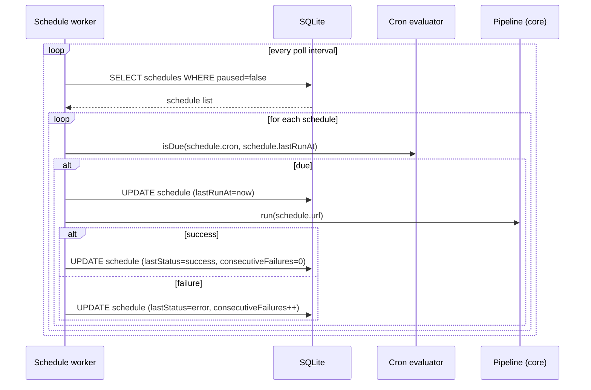

# Explanation: Pipeline

How WebFrost archives a URL — from request to stored snapshot.

Diagrams use [Mermaid](https://mermaid.js.org/). Standalone `.mmd` files are in [`docs/diagrams/sequences/`](../diagrams/sequences/).

---

## Archive pipeline

A single URL archive run from submission to completion.

---

## Download flow

How the server resolves and serves an archive file download request.

---

## Import flow

How a bulk import (plain text, OPML, RSS, Netscape HTML) is processed.

---

## Schedule flow

How a scheduled archive is triggered and executed.

---

## Key design choices

- **Parallel extractors, single navigation.** All extractors for one URL share one Playwright page instance and one HTTP fetch cache. This means one DNS lookup, one TLS handshake, one page load — regardless of how many extractors run.

- **Sync import history.** The import module tracks every imported URL in `import_history`. Re-importing the same file or feed skips already-imported URLs, making re-runs idempotent.

- **No external queue.** The archive queue is in-memory, bounded by `WEBFROST_CONCURRENCY`. For higher throughput a persistent queue would be needed, but for self-hosted use cases the simplicity is worth it.

For the component-level view, see [Explanation: Architecture](./architecture.md).
