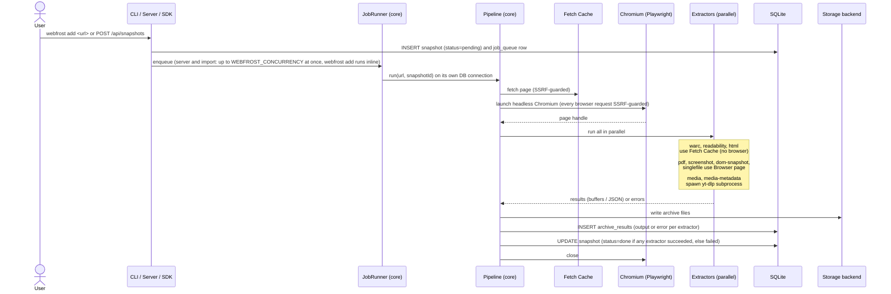
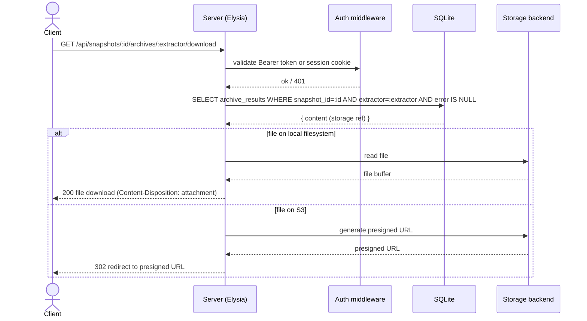
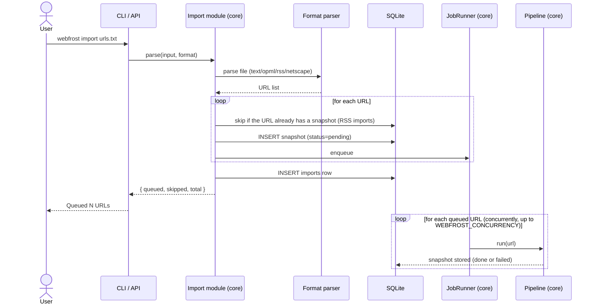
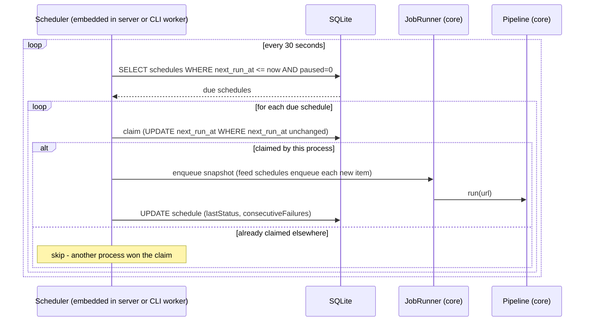

# Explanation: Pipeline

How WebFrost archives a URL — from request to stored snapshot.

Diagrams use [Mermaid](https://mermaid.js.org/). Standalone `.mmd` files are in [`docs/diagrams/sequences/`](../diagrams/sequences/).

---

## Archive pipeline

A single URL archive run from submission to completion.

---

## Download flow

How the server resolves and serves an archive file download request.

---

## Import flow

How a bulk import (plain text, OPML, RSS, Netscape HTML) is processed.

---

## Schedule flow

How a scheduled archive is triggered and executed.

---

## Key design choices

- **Parallel extractors, single navigation.** All extractors for one URL share one Playwright page instance and one HTTP fetch cache. This means one DNS lookup, one TLS handshake, one page load — regardless of how many extractors run.

- **One job runner, bounded concurrency.** Every pipeline the server starts (`POST /api/snapshots`, imports, schedules) goes through a single `JobRunner` (`packages/core/src/jobs.ts`), limited to `WEBFROST_CONCURRENCY` pipelines at once (default 3). Each job opens its own database connection. `job_queue.status` goes `pending` → `running` → `done` or `failed`. At startup the server (and `webfrost schedule worker`) re-queues snapshots a previous run left `pending`, so a restart or crash does not strand them.

- **Snapshot status is `pending`, `done` or `failed`.** A snapshot is `done` when at least one extractor produced output, and `failed` when the page could not be fetched or no extractor succeeded. Browser extractors (pdf, screenshot, dom-snapshot, singlefile) that cannot run — Chromium missing, navigation failed, SSRF policy violation — are recorded in `archive_results` with an `error` and show up as `status: "failed"` in the API's `extractorMeta`. Media extraction is skipped silently when `yt-dlp` is not installed or the URL is not a media page.

- **Timeouts and politeness.** The page fetch, each extractor and each `yt-dlp` run have their own timeouts (`WEBFROST_FETCH_TIMEOUT_MS`, `WEBFROST_EXTRACTOR_TIMEOUT_MS`, `WEBFROST_MEDIA_TIMEOUT_MS`), browser navigation is capped at 30 s, and two archives of the same hostname start at least `WEBFROST_DOMAIN_DELAY_MS` apart (default 1 s). See [Environment variables](/reference/environment-variables).

- **SSRF guard.** The page fetch and every request the headless browser makes are checked against the SSRF policy. Details are in [Security](/SECURITY).

- **Deduplication by URL.** RSS imports skip URLs that already have a snapshot and report them as `skipped`; the `imports` table only records a history of each import operation.

- **Embedded scheduler.** The server polls for due schedules every 30 s and claims each one atomically, so it can run next to `webfrost schedule worker` on the same archive without double-running.

- **No external queue.** The runner is in-process and bounded by `WEBFROST_CONCURRENCY`; the `pending` rows in SQLite are what survive a restart. For higher throughput a persistent distributed queue would be needed, but for self-hosted use cases the simplicity is worth it.

For the component-level view, see [Explanation: Architecture](./architecture.md).
